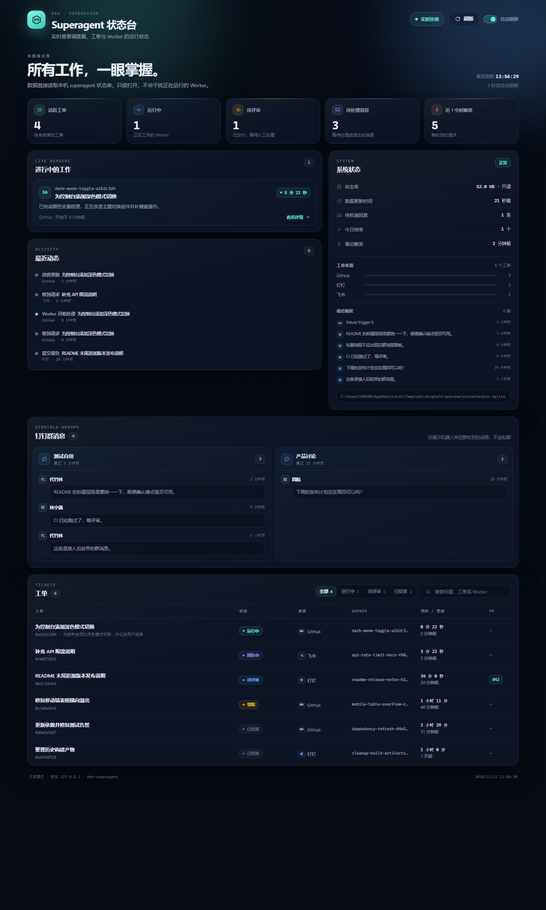

# python-service-web

Sample repository used to test the dsh-superagent prototype.
Hello from dsh-superagent
Hello from DingTalk

## Superagent 状态台

一个零依赖、只读的本地监控页面，用来查看 dsh-superagent 的调度器、工单和 Worker 状态。



### 能力

- **总览**：活跃工单、运行中的 Worker、待评审工单、待处理消息和最近触发。
- **进行中的工作**：实时显示 Worker 名称、当前任务、已运行时间和最新进度。
- **最近动态**：按时间倒序展示接单、进度、报告和结束事件。
- **系统状态**：状态库大小与更新时间、待投递回复、今日结束数、来源分布和最近触发。
- **钉钉群消息**：按群展示机器人所在群收到的消息（发送人、时间和正文），不包含私聊，也不回溯接入前的历史记录。
- **工单列表**：按状态筛选、搜索标题 / 工单 ID / Worker，并可直接打开 PR。
- **工单详情**：最新报告全文、时间线、Worker 目录和来源会话链接；支持 `?ticket=<id>` 深链接。
- **主题切换**：右上角在浅色和深色主题之间切换，选择会保存在本机浏览器。
- 每 5 秒自动刷新，也可以暂停或手动刷新；页面适配桌面和移动端。

### 运行

需要 Python 3.10+（项目本身不依赖第三方包）。

```powershell
# Windows
py app.py

# macOS / Linux
python3 app.py
```

然后打开 <http://127.0.0.1:8765/>。

默认读取 `~/.dsh/state/superagent/orchestrator.sqlite`。也可以通过参数或环境变量指定：

```powershell
py app.py --state-dir "C:\Users\me\.dsh\state\superagent"
py app.py --port 9000
```

```powershell
$env:SUPERAGENT_STATE_DIR = "C:\Users\me\.dsh\state\superagent"
$env:SUPERAGENT_STATUS_PORT = "9000"
py app.py
```

`py app.py --help` 可以查看全部选项。

### 安全说明

- 状态库始终以 SQLite `mode=ro` 打开，页面不会写入、迁移或锁定状态库。
- 页面默认只绑定 `127.0.0.1`，不向局域网暴露。工单标题、来源消息、钉钉群消息和报告摘要属于本机私有数据，请勿用 `--host 0.0.0.0` 对外开放。
- 页面不加载任何外部资源，并设置 CSP、`nosniff`、`Referrer-Policy: no-referrer` 等响应头。

### 测试

```powershell
py -m unittest discover -s tests -t . -v
```

测试会使用 `tests/fixtures.py` 生成的合成状态库，不读取真实数据。

### 结构

```
app.py                         启动入口
superagent_status/store.py     只读读取 SQLite 并生成视图模型
superagent_status/server.py    标准库 HTTP 服务与静态资源
superagent_status/static/      页面、样式和原生 JavaScript
tests/                         单元测试、HTTP 测试与合成数据
docs/screenshots/              UI 截图
```
